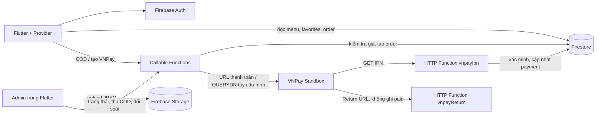

# Kiến trúc hiện tại

## Dữ liệu và quyền

- **Auth:** Email/Password trong Flutter. `UserProvider` đọc Firebase Auth
  custom claim `admin`; trường `role` trong hồ sơ không cấp quyền. Công cụ
  `functions/grant_admin.js` chỉ chạy từ máy quản trị với Admin SDK.
- **Catalog:** `categories.name` là key bất biến để lọc `products.category`.
  Admin có thể đổi tên hiển thị, thứ tự và trạng thái; danh mục không xóa
  cứng. Admin có thể lưu trữ sản phẩm bằng `isArchived` và `isAvailable`.
  Firestore rules cho đọc catalog công khai, chỉ Admin claim được ghi.
  Category document ID phải bằng key `name`; product ghi mới/sửa phải tham
  chiếu category còn hoạt động. Backend checkout kiểm tra lại category này.
- **Ảnh:** Admin form kiểm tra JPEG nhỏ hơn 5 MB; Storage rules cũng giới hạn
  claim, loại, dung lượng và đường dẫn `products/*.jpg`. Mỗi upload mới có
  đường dẫn phiên bản; Storage rules không cho client xóa ảnh.
- **User data:** Hồ sơ và favorites theo UID với Firestore rules. Địa chỉ lưu
  bằng Shared Preferences theo key chứa UID, không đồng bộ thiết bị. Giỏ hàng
  là state trong bộ nhớ và đổi UID sẽ xóa. `FavoritesProvider` xóa danh sách
  khi bind UID khác, bỏ response tải cũ và chỉ cập nhật UI sau khi Firestore
  ghi thành công; lỗi tải/ghi có trạng thái để thử lại.

## Checkout và thanh toán

1. Flutter gửi `productId`, size, số lượng, cách nhận, địa chỉ, `requestId`
   và tổng tiền dự kiến. Backend đọc sản phẩm, từ chối món ngừng bán, tính lại
   giá S/M/L và tổng tiền, so với dự kiến rồi tạo order theo
   `<uid>_<requestId>` trong transaction. Retry cùng request không tạo đơn thứ
   hai. Order lưu snapshot tên, giá đơn vị, size và số lượng.
2. **COD:** `placeOrder` tạo `paymentStatus: unpaid`. `orderStatus` mô tả xử
   lý đơn, độc lập với `paymentStatus`. Admin gọi `updateOrderStatus` theo đồ
   thị chuyển trạng thái trong `functions/admin_orders.js`; khi đã nhận tiền,
   Admin gọi `collectCodPayment`. Function kiểm tra claim, ghi `paidAt`,
   `paidBy` và audit; gọi lặp không ghi nhận lần hai.
3. **VNPay Sandbox:** `createVnpayPayment` tạo order `pending`, ký URL API 2.1.0
   bằng HMACSHA512 từ secret backend. App mở `payUrl` bằng trình duyệt ngoài,
   không ghi thanh toán. `vnpayIpn` xác minh checksum, mã tham chiếu, số tiền,
   mã giao dịch và kết quả trước khi cập nhật. `vnpayReturn` chỉ hiển thị
   hướng dẫn quay lại app. QUERYDR qua `reconcileVnpayPayment` mặc định tắt;
   khi đã bật và kiểm chứng Sandbox, Function giới hạn một truy vấn mỗi đơn
   trong 5 phút và chỉ ghi `paid` khi phản hồi ký hợp lệ, khớp order và amount.
   Kết quả chưa rõ giữ `pending`. Callback trễ được xử lý
   idempotent. Chưa kiểm chứng bằng giao dịch Sandbox thật.

Firestore rules không cho client tạo/sửa order hoặc audit; Admin UI chỉ gọi
Callable Functions. `status` được ghi song song với `orderStatus` để các màn
cũ đọc được dữ liệu, còn `paymentStatus` tách riêng. Dashboard tính tiền đã
thu từ đơn `paid` chưa hủy; đơn cũ thiếu `paymentStatus` không được tính là
đã thu.

## Mã nguồn liên quan

- `lib/main.dart`, `lib/providers/`, `lib/screens/order_screen.dart`,
  `lib/screens/admin/`
- `functions/order_logic.js`, `functions/place_order.js`,
  `functions/admin_orders.js`, `functions/vnpay.js`, `functions/vnpay_reconcile.js`
- `firestore.rules`, `storage.rules`, `functions/test/`, `test/`

Xem `SECURITY_SETUP.md` để cấu hình Firebase và `TESTING.md` để chạy test/CI.
